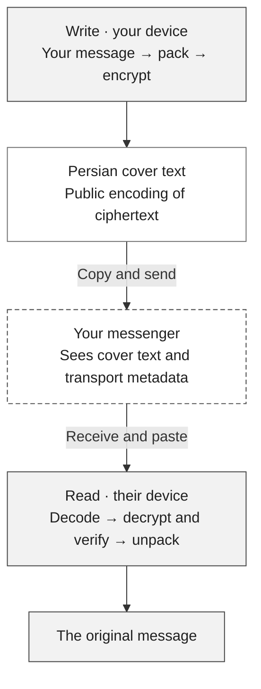
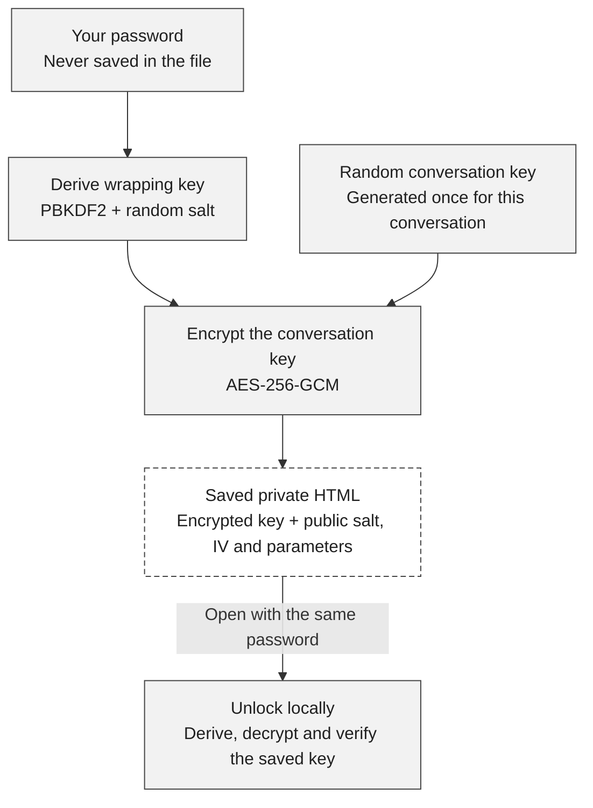

<h1 align="center">BodoPechPech · بدو پچ پچ</h1>

<p align="center">Write a message. Send Persian cover text. Read the original on the other side.</p>
<p align="center"><strong>One offline HTML file · No account · No installation · No AI</strong></p>

<p align="center">
  <a href="https://github.com/BodoVPN/bodo-pech-pech/releases/latest/download/bodo-pech-pech.html"><strong>Download / دریافت فایل</strong></a>
  &nbsp; · &nbsp;
  <a href="https://github.com/BodoVPN/bodo-pech-pech/releases/latest">Latest release</a>
  &nbsp; · &nbsp;
  <a href="#how-it-works">How it works</a>
  &nbsp; · &nbsp;
  <a href="#the-message-protocol">Protocol</a>
  &nbsp; · &nbsp;
  <a href="#protocol-history">History</a>
</p>

<p align="center">
  <picture><source media="(prefers-color-scheme: dark)" srcset="docs/assets/home-fa-dark.png"></picture>
</p>
<p align="center"><sub>BodoPechPech v0.4.1, offline in Windows Chrome. Light and dark follow your system. No message content is shown.</sub></p>

**[v0.4.1](https://github.com/BodoVPN/bodo-pech-pech/releases/tag/v0.4.1)** includes the monochrome branding shown here. The download is the released, self-contained HTML; [SHA256SUMS.txt](https://github.com/BodoVPN/bodo-pech-pech/releases/latest/download/SHA256SUMS.txt) records its checksum. Earlier tags and release files remain unchanged.

## Quick start

1. **Download and open** the HTML in Chrome or Edge.
2. **One person creates the conversation.** Choose a password or **Generate**, then **Make & save conversation file**.
3. **Share that same saved file privately.** Give the other person a copy and tell them the password separately. Both people need copies of **the same file**, not two independently created conversations.
4. **Open, unlock, and talk.** **Write a message** prepares Persian text to copy into your messenger. **Read a message** opens the received text you paste in. Copy all of it without changing the words.

<div dir="rtl">
<h2>شروع سریع</h2>
<ol>
  <li>فایل را <strong>دانلود کنید و در Chrome یا Edge باز کنید</strong>.</li>
  <li><strong>یک نفر گفت‌وگو را بسازد:</strong> رمز انتخاب کند یا «ساخت خودکار» را بزند، سپس «ساخت و ذخیرهٔ فایل گفت‌وگو» را بزند.</li>
  <li><strong>همان فایل ذخیره‌شده را خصوصی به نفر دوم بدهید</strong> و رمز را جداگانه برسانید. هر دو باید نسخه‌ای از <strong>همان فایل</strong> داشته باشید، نه دو گفت‌وگوی جدا.</li>
  <li>فایل خصوصی را باز کنید و رمز را وارد کنید. <strong>نوشتن پیام</strong> متن فارسی برای کپی در پیام‌رسان می‌سازد؛ در <strong>خواندن پیام</strong> متن دریافتی را بچسبانید. همهٔ متن را بدون تغییر کلمات کپی کنید.</li>
</ol>
<p>رمز را نگه دارید؛ فراموشی آن ممکن است دسترسی را از بین ببرد. برای گفت‌وگوی قبلی، «محافظت از گفت‌وگوی قبلی» را بزنید؛ نسخه‌های قدیمیِ بدون محافظت با این کار امن یا باطل نمی‌شوند.</p>
</div>

Passwords need **8 characters, a number and a symbol**; Persian/Arabic digits work too. **Generate** fills an editable random **16-character** suggestion. Keep it safe—there is no password reset. [Moving an old file or setup code?](#keep-an-existing-conversation)

<p align="center">
  <picture><source media="(prefers-color-scheme: dark)" srcset="docs/assets/unlock-en-dark.png"></picture>
  <picture><source media="(prefers-color-scheme: dark)" srcset="docs/assets/home-en-dark.png"></picture>
</p>
<p align="center"><sub>Unlock once, then choose Write or Read. Narrow desktop-browser views—not Android test results.</sub></p>

Switching to your messenger and **Done · clear messages** keep this tab unlocked. Done clears message fields and reply context. Closing, reloading or navigating away requires unlocking again. The monochrome light/dark theme follows your system automatically, with no extra setup or saved preference.

## How it works

Think of it as **a locked key, an encrypted message, and a change of appearance**. They do different jobs:

| Part | What it does |
| --- | --- |
| **Your password** | Protects the conversation key inside the saved HTML file. |
| **The random conversation key** | Encrypts and authenticates messages. Both people use the same key; a new conversation gets a fresh one. |
| **The Persian wording** | Represents the encrypted bytes as sentences. Anyone can reverse this public encoding to ciphertext; it adds no cryptographic strength. |

The public starter download has **no private conversation key**. Setup creates one locally. The file you deliberately save contains its encrypted form, never the password or plaintext key.

### 1 · A message goes across



**Shaded steps happen locally; the dashed box is the messenger.** It transports the cover text and is not trusted to encrypt the private message. It can see the cover, participants, timing and length.

The receiver needs the conversation key to decrypt and authenticate the ciphertext. The app verifies it **before** showing the original text. A wrong key or modified message fails instead of producing a guessed message.

**Reply takes the same path back.** The public cover provides rough topic/turn continuity. No AI reads, summarizes or rewrites the private text. The wording can still sound artificial, and short messages can produce long covers.

### 2 · The saved key stays locked



This protects a **stolen, locked file** against access without the password, subject to password guessing and implementation limits. It does not protect an already-unlocked or compromised device. The password, derived wrapping key and raw conversation key are not saved in new exports.

<details>
<summary><strong>A closer look at the bytes</strong></summary>

**Saving the key.** Setup generates a random **32-byte conversation key**. The password is normalized to **NFC**, then encoded as UTF-8: spaces are not trimmed, and Persian/Arabic letters are not substituted. **PBKDF2-HMAC-SHA-256 at 600,000 iterations**, with a random **16-byte salt**, derives the temporary wrapping key. **AES-256-GCM**, with a fresh **12-byte IV**, encrypts the conversation key. The envelope's version/parameters are authenticated, with a **128-bit tag**. Only the encrypted key and public salt/IV/parameters go into the saved HTML. Unlock repeats derivation, authenticates/decrypts, and imports the recovered key locally as a non-extractable `CryptoKey`. [Storage specification →](docs/KEY-STORAGE.md)

**Staying local.** There is no server, AI model, application network request or browser-storage persistence. The existing messenger provides transport and may need internet. Exports use a clean build-time template, never the live message screen. Clearing cannot guarantee erasure from browser/OS memory or clipboard history. [Implementation →](src/main.ts)

</details>

## The message protocol

The protocol defines how **exact message bytes become encrypted bytes, then Persian words, and back again**. The words are a public alphabet for the encrypted packet. Knowing the grammar lets anyone recover that packet; reading or forging a valid private message requires the shared conversation key. This is a bespoke cover protocol built around established cryptography, not a new cipher.

### From message to words

1. **Preserve and pack.** The private text becomes 1–2,048 UTF-8 bytes without trimming or Unicode normalization. In v2, a fixed table can represent common Persian/Arabic byte sequences with shorter tokens. Persian and Arabic letter variants remain distinct. Packing is used only when shorter; otherwise a one-byte mode flag precedes the original bytes. It is lossless byte substitution, with no model or shared compression history.
2. **Encrypt and authenticate.** A random 32-byte conversation key drives AES-256-GCM. Every send samples a fresh 12-byte nonce with the browser's cryptographic random generator. The packet contains a five-byte header, the nonce, ciphertext and a 16-byte authentication tag. The header is `BPP`, message version `02`, and public profile `P`. It is authenticated as additional data, so a changed version/profile cannot silently produce an accepted message.
3. **Frame the packet.** V2's opener identifies one of **30 profiles**: six themes × five conversational acts. The body carries the first nonce byte, a two-byte packet length, the remaining nonce bytes, ciphertext and tag. The fixed magic/version/profile are reconstructed from the recognized opener. This avoids repeating them in the body; placing length near the start lets both sides follow the same grammar schedule. Nonce, profile and length are public, not secrets.
4. **Turn bits into phrases.** Ordered tables map bits to sentence structures, subjects and other word choices. For example, three bits choose among eight available structures; five bits choose among 32 available subjects. The previous choice is excluded to prevent immediate repetition. The body progresses through observations, preferences and tentative continuation. For a given packet the grammar is deterministic; fresh encryption changes the packet and therefore the wording. It does not understand or paraphrase the private message.

The current app uses the previous public cover for rough reply continuity. The codec also has bounded rules for visible greetings, invitations and questions; the simple app does not expose extra theme/act controls. Private text never chooses the theme, and the receiver needs no earlier chat history. These are limited public cues, not conversation intelligence.

### From words back to the exact message

The reader recognizes the opener, follows the same ordered grammar, reconstructs the packet and **verifies authenticated decryption before unpacking or displaying text**. Choice tables are prefix-free after normalization: one valid choice cannot be mistaken for the beginning of another in the same slot. Length, full input consumption and zero-only final padding are checked. Unknown words, missing sentences, appended content, unsupported versions and invalid authentication fail; there is no fuzzy repair or guessed plaintext.

Copy/paste tolerance applies **only to cover text**: NFKC, Arabic/Persian yeh and kaf compatibility, and removal of whitespace, punctuation and the specified diacritics/format marks. Invisible characters carry no payload. Equivalent spacing, punctuation or the alternate opener for the same profile may still decode; authentication protects the reconstructed packet/profile, not the literal typography. Translation, synonyms and manual rewording are not supported. [Exact normalization rules →](docs/FORMAT.md#copypaste-normalization)

Private Unicode, emoji, combining sequences, spaces and an initial BOM are preserved. Invalid lone surrogates are rejected. Browser textareas normalize line endings to LF **before** the app reads them; the underlying byte API preserves arbitrary bytes. The cover input limit is 180,000 UTF-16 code units, and decrypted output is bounded before display. Public cover length still leaks size information, and even a tiny message needs a long cover for the nonce, tag and framing.

### Three different kinds of version

| Version | What it describes | Compatibility |
| --- | --- | --- |
| **Message v1 / v2** | Packet and Persian cover grammar | Current files write v2 and read both. Old v1-only files cannot read v2; both people should use the current app with the same conversation key. |
| **BPK1, storage version 1** | Password-protected key inside a private HTML file | Wraps the same random key; does not change message v1/v2. Old unprotected **BPP1 setup codes** are a separate legacy key-sharing format. |
| **App v0.4.1** | This HTML application and its documentation | Publishes full branding and automatic light/dark themes. It introduces no message-format or storage-format revision. |

Wire tables and their order are part of the protocol: changing them requires a new message version. See [v2 framing, packing and grammar](docs/FORMAT-V2.md), [preserved v1 specification](docs/FORMAT.md), [BPK1 key storage](docs/KEY-STORAGE.md), and the implementation in [crypto.ts](src/crypto.ts), [dialogue.ts](src/dialogue.ts), [dialogue-data.ts](src/dialogue-data.ts) and [packing.ts](src/packing.ts).

## Protocol history

This is a young experimental project. **The repository milestones below all occurred on 10 October 2026**; they do not establish long field use, an independent audit or a new cryptographic invention. The 0.1/0.2 entries are development commits, not published GitHub releases.

| Milestone | What changed, and why |
| --- | --- |
| **0.1 development · message v1** — [initial implementation](https://github.com/BodoVPN/bodo-pech-pech/commit/bd94d30eaeb161713d46e16ee37f5c95416325e4) | Proved an offline round trip using AES-GCM and a fixed Persian phrase codec. Four 16-entry slots encoded 16 bits per sentence across three topics. It was reversible but very verbose and repetitive. |
| **0.2 development · message v2** — [codec revision](https://github.com/BodoVPN/bodo-pech-pech/commit/c859a3badb2b193ff4e930fa9361b23a1ebf4cd2) | Added exact byte packing, six themes, five acts, varied sentence structures, non-repeating adjacent choices and three-stage progression to reduce length and improve bounded continuity. Kept AES-GCM/shared-key setup and v1 reading. The direction remained explicitly non-AI. |
| **App v0.3.0** — [private-file redesign](https://github.com/BodoVPN/bodo-pech-pech/commit/69c2357d7a9a2a3820e9b1fa1020dd464b4710af), [release](https://github.com/BodoVPN/bodo-pech-pech/releases/tag/v0.3.0) | Replaced routine setup-code handling with a shared private HTML file and a simple Write/Read/Reply flow; embedded Persian typography followed. These older files stored the key without password protection. The message protocol stayed v2. |
| **App v0.4.0** — [protected-key change](https://github.com/BodoVPN/bodo-pech-pech/commit/eafdcafe3ee9fc7c79360dde7eeb0cb808b02958), [release](https://github.com/BodoVPN/bodo-pech-pech/releases/tag/v0.4.0) | Added the separate BPK1 envelope so a saved file no longer carries a plaintext key, plus one-time unlock, legacy-key migration and password generation. PBKDF2 was chosen for native, self-contained browser support; guessing remains possible offline. Neither message format changed. |
| **App v0.4.1** — [branding change](https://github.com/BodoVPN/bodo-pech-pech/commit/842d0dacfc6c6e98b9f2b53c868e5a93b4174315), [release](https://github.com/BodoVPN/bodo-pech-pech/releases/tag/v0.4.1) | Releases the full BodoPechPech / بدو پچ پچ brand, monochrome system light/dark themes, real screenshots and protocol/history documentation. No new cipher, message grammar or key-storage format. |

The recorded [v1/v2 comparison](docs/VERIFICATION-V2.md) used pinned builds and 360 authenticated exact round trips on Windows Chrome/Edge. Its 67-byte Persian reference averaged 2,980 cover characters in v1 and 1,868 in v2 across 20 encryptions per format. That is one measured example, not a universal reduction or a phone benchmark. The report and [complete samples](docs/COVER-SAMPLES.md) also show remaining repetition, strained phrases and long covers; no fluency study or steganalysis established undetectability.

**The older foundations are the cryptographic building blocks.** NIST documented GCM authenticated encryption in [SP 800-38D (2007)](https://csrc.nist.gov/pubs/sp/800/38/d/final); PBKDF2 is specified in [RFC 8018 §5.2 (2017)](https://www.rfc-editor.org/rfc/rfc8018.html#section-5.2). The browser implementation uses the [W3C Web Cryptography API](https://www.w3.org/TR/2017/REC-WebCryptoAPI-20170126/). Those established primitives do not validate this project's custom framing, Persian grammar, key handling or application. BodoPechPech remains bespoke and unaudited. [Browse the repository history →](https://github.com/BodoVPN/bodo-pech-pech/commits/main/)

## Security limits

> **Experimental and not independently audited.** Persian cover text is detectable encoding, not a guarantee of naturalness, concealment or secure-messenger equivalence. Read the [security boundaries](SECURITY.md) before relying on it.

- **Passwords can be guessed offline.** Meeting the eight-character minimum does not make a chosen password strong; the generated value is the stronger option. Losing the password can lose access.
- **Handover matters.** Use a trusted HTML copy, share the same private file confidentially, and share its password separately. Old unprotected files/codes remain usable after migration.
- **Both people share one key.** There is no sender-specific authentication, forward secrecy or replay protection. A compromised device is outside this protection.
- **Transport remains visible.** The messenger and observers can see cover text and transport metadata. Copy/paste changes or truncation can prevent a message from opening.

## Keep an existing conversation

In the starter, choose a password, open **Protect an older conversation**, and select the old private HTML file **or** paste its BPP1 setup code. Save the protected copy. It keeps the original key and reads existing v1/v2 messages; old HTML is read as data, never executed.

Existing protected files still accept their original passwords, even if they do not meet today's creation rules. **Migration does not secure or revoke old unprotected copies.** [Migration details →](docs/KEY-STORAGE.md#runtime-and-migration)

## Compatibility

| Platform | Status |
| --- | --- |
| **Windows Chrome & Edge** | Actual saved-file, offline exchange and reply flows tested. |
| **Android / Galaxy A51-class phones** | Target platform; **not verified on a real device**. |

The current single file is about **411 KiB**, with its font, CSS and script embedded. Open it in a full browser, not a file previewer. See [current verification](docs/BRANDING-VERIFICATION.md), [v0.4.0 release verification](docs/VERIFICATION.md) and the [Android checklist](docs/ANDROID-CHECK.md).

## Build and check

Users need only the downloaded HTML. Developers need Node.js 24+ and npm:

```sh
npm ci
npm run check
```

`npm run build` produces `bodo-pech-pech.html`; do not distribute the unbundled source page. Browser checks use installed Chrome and Edge. Keep personal conversation files out of Git.

| Explore | Read more |
| --- | --- |
| Formats | [Message v2](docs/FORMAT-V2.md) · [Legacy v1](docs/FORMAT.md) · [Protected key storage](docs/KEY-STORAGE.md) |
| Evidence | [Current verification](docs/BRANDING-VERIFICATION.md) · [v0.4.0 verification](docs/VERIFICATION.md) · [Historical codec comparison](docs/VERIFICATION-V2.md) |
| Visuals | [Screenshot provenance](docs/assets/README.md) · [Font attribution](assets/fonts/vazirmatn/README.md) |

Typography uses **Vazirmatn v33.003**, embedded with its SIL Open Font License 1.1 and attribution. No project software license has been selected. No AI is shipped; the [earlier model investigation](docs/MODEL-NOTE.md) is historical only.
