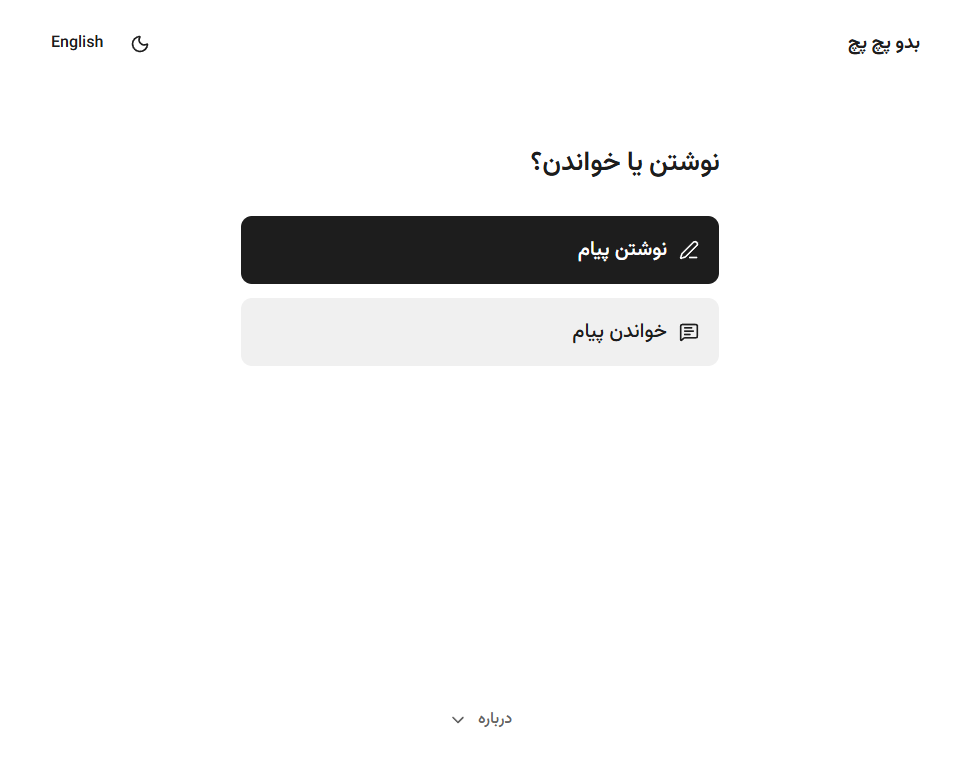
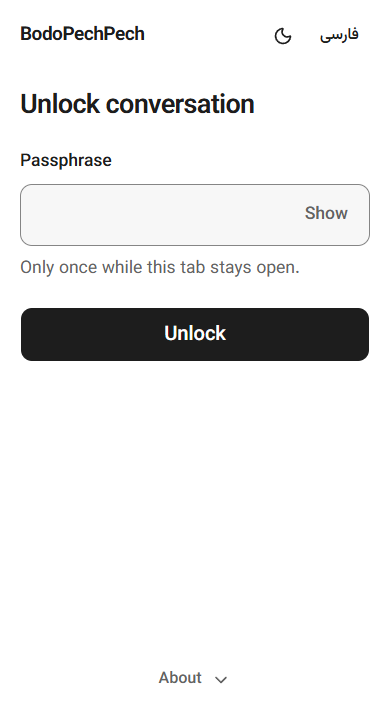
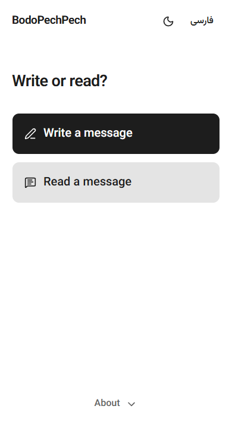
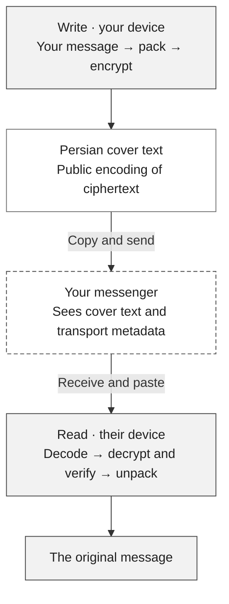
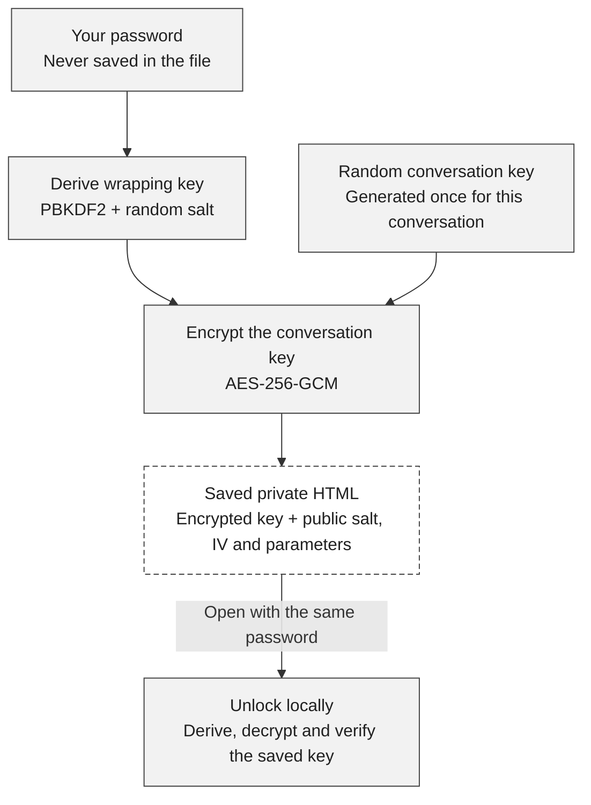
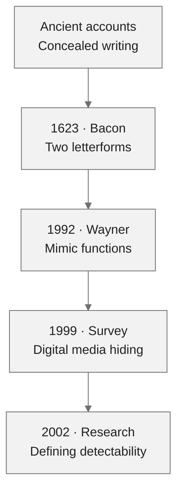

<h1 align="center">BodoPechPech · بدو پچ پچ</h1>

<p align="center">Write a message. Send Persian cover text. Read the original on the other side.</p>
<p align="center"><strong>One offline HTML file · No account · No installation · No AI</strong></p>

<p align="center">
  <a href="https://github.com/BodoVPN/bodo-pech-pech/releases/latest/download/bodo-pech-pech.html"><strong>Download / دریافت فایل</strong></a>
  &nbsp; · &nbsp;
  <a href="https://github.com/BodoVPN/bodo-pech-pech/releases/latest">Latest release</a>
  &nbsp; · &nbsp;
  <a href="#how-it-works">How it works</a>
  &nbsp; · &nbsp;
  <a href="#steganography">Steganography</a>
  &nbsp; · &nbsp;
  <a href="#a-short-history-of-steganography">History</a>
</p>

<p align="center">
  <picture><source media="(prefers-color-scheme: dark)" srcset="docs/assets/home-fa-dark.png"></picture>
</p>
<p align="center"><sub>BodoPechPech v0.5.0, offline in Windows Chrome. Switch light/dark from the header on any screen. No message content is shown.</sub></p>

**[v0.5.0](https://github.com/BodoVPN/bodo-pech-pech/releases/tag/v0.5.0)** rebuilds every screen with React and genuine shadcn/ui components: a quiet monochrome canvas, compact task screens, comfortable controls, and Persian/English layouts. The download is the released, self-contained HTML; [SHA256SUMS.txt](https://github.com/BodoVPN/bodo-pech-pech/releases/latest/download/SHA256SUMS.txt) records its checksum. Earlier tags and release files remain unchanged.

## Quick start

1. **Download and open** the HTML in Windows Chrome or Edge. iPhone/iPad attachment previews are not supported; Android still needs real-device testing.
2. **One person creates the conversation.** Choose a password or **Generate**, then **Save conversation file**.
3. **Share that same saved file privately.** Give the other person a copy and tell them the password separately. Both people need copies of **the same file**, not two independently created conversations.
4. **Open, unlock, and talk.** **Write a message** prepares Persian text to copy into your messenger. **Read a message** opens the received text you paste in. Copy all of it without changing the words.

**Windows says the private file cannot be opened?** Open the public starter HTML in Chrome or Edge, choose **Open saved conversation**, select your existing private HTML, and enter its original password. The app reads it locally as data; it does not run that attachment's scripts, upload it, change its key, or change Windows security settings. After reloading the starter, select the file again. [Opening help and platform limits →](docs/OPENING-FILES.md)

<div dir="rtl">
<h2>شروع سریع</h2>
<ol>
  <li>فایل را <strong>دانلود کنید و در Chrome یا Edge ویندوز باز کنید</strong>. پیش‌نمایش پیوست iPhone و iPad پشتیبانی نمی‌شود؛ اندروید هنوز به آزمایش واقعی نیاز دارد.</li>
  <li><strong>یک نفر گفت‌وگو را بسازد:</strong> رمز انتخاب کند یا «ساخت خودکار» را بزند، سپس «ساخت و ذخیرهٔ فایل» را بزند.</li>
  <li><strong>همان فایل ذخیره‌شده را خصوصی به نفر دوم بدهید</strong> و رمز را جداگانه برسانید. هر دو باید نسخه‌ای از <strong>همان فایل</strong> داشته باشید، نه دو گفت‌وگوی جدا.</li>
  <li>فایل خصوصی را باز کنید و رمز را وارد کنید. <strong>نوشتن پیام</strong> متن فارسی برای کپی در پیام‌رسان می‌سازد؛ در <strong>خواندن پیام</strong> متن دریافتی را بچسبانید. همهٔ متن را بدون تغییر کلمات کپی کنید.</li>
</ol>
<p>اگر ویندوز فایل خصوصی را باز نمی‌کند، فایل اولیه را در Chrome یا Edge باز کنید، <strong>باز کردن گفت‌وگوی ذخیره‌شده</strong> را بزنید، فایل خصوصی قبلی را انتخاب کنید و رمز همان فایل را وارد کنید. فایل فقط روی همین دستگاه خوانده می‌شود؛ کلید، فایل و تنظیمات امنیتی تغییر نمی‌کنند. پس از بارگذاری دوبارهٔ فایل اولیه، فایل خصوصی را دوباره انتخاب کنید.</p>
<p>دکمهٔ <strong>خورشید / ماه</strong> بالای همهٔ صفحه‌هاست. رنگ اولیه از دستگاه گرفته می‌شود؛ پس از انتخاب شما، تغییر رنگ دستگاه آن را عوض نمی‌کند. با بارگذاری دوباره، رنگ دستگاه دوباره استفاده می‌شود؛ تنظیمی ذخیره نمی‌شود.</p>
<p>رمز را نگه دارید؛ فراموشی آن ممکن است دسترسی را از بین ببرد. برای گفت‌وگوی قبلی، در «درباره»، «محافظت از گفت‌وگوی قبلی» را بزنید؛ نسخه‌های قدیمیِ بدون محافظت با این کار امن یا باطل نمی‌شوند.</p>
</div>

Passwords need **8 characters, a number and a symbol**; Persian/Arabic digits work too. **Generate** fills an editable random **16-character** suggestion. Keep it safe—there is no password reset. [Moving an old file or setup code?](#keep-an-existing-conversation)

<p align="center">
  <picture><source media="(prefers-color-scheme: dark)" srcset="docs/assets/unlock-en-dark.png"></picture>
  <picture><source media="(prefers-color-scheme: dark)" srcset="docs/assets/home-en-dark.png"></picture>
</p>
<p align="center"><sub>Unlock once, then choose Write or Read. Narrow desktop-browser views—not Android test results.</sub></p>

Switching to your messenger and **Done** keep this tab unlocked. Done clears message fields and reply context. Closing, reloading or navigating away requires unlocking again.

Use the **sun/moon button** in the header on any screen to switch light/dark. Its accessible name and tooltip describe the destination mode. The initial theme follows your system; once you choose, later system changes do not override it. Your choice lasts until reload or close. No preference is stored, and switching themes does not clear a draft or lock the conversation.

## How it works

Think of it as **a locked key, an encrypted message, and a change of appearance**. They do different jobs:

| Part | What it does |
| --- | --- |
| **Your password** | Protects the conversation key inside the saved HTML file. |
| **The random conversation key** | Encrypts and authenticates messages. Both people use the same key; a new conversation gets a fresh one. |
| **The Persian wording** | Represents the encrypted bytes as sentences. Anyone can reverse this public encoding to ciphertext; it adds no cryptographic strength. |

The public starter download has **no private conversation key**. Setup creates one locally. The file you deliberately save contains its encrypted form, never the password or plaintext key.

### 1 · A message goes across



**Shaded steps happen locally; the dashed box is the messenger.** It transports the cover text and is not trusted to encrypt the private message. It can see the cover, participants, timing and length.

The receiver needs the conversation key to decrypt and authenticate the ciphertext. The app verifies it **before** showing the original text. A wrong key or modified message fails instead of producing a guessed message.

**Reply takes the same path back.** The public cover provides rough topic/turn continuity. No AI reads, summarizes or rewrites the private text. The wording can still sound artificial, and short messages can produce long covers.

### 2 · The saved key stays locked



This protects a **stolen, locked file** against access without the password, subject to password guessing and implementation limits. It does not protect an already-unlocked or compromised device. The password, derived wrapping key and raw conversation key are not saved in new exports.

<details>
<summary><strong>A closer look at the bytes</strong></summary>

**Saving the key.** Setup generates a random **32-byte conversation key**. The password is normalized to **NFC**, then encoded as UTF-8: spaces are not trimmed, and Persian/Arabic letters are not substituted. **PBKDF2-HMAC-SHA-256 at 600,000 iterations**, with a random **16-byte salt**, derives the temporary wrapping key. **AES-256-GCM**, with a fresh **12-byte IV**, encrypts the conversation key. The envelope's version/parameters are authenticated, with a **128-bit tag**. Only the encrypted key and public salt/IV/parameters go into the saved HTML. Unlock repeats derivation, authenticates/decrypts, and imports the recovered key locally as a non-extractable `CryptoKey`. [Storage specification →](docs/KEY-STORAGE.md)

**Staying local.** There is no server, AI model, application network request or browser-storage persistence. The existing messenger provides transport and may need internet. Exports use a clean build-time template, never the live message screen. Clearing cannot guarantee erasure from browser/OS memory or clipboard history. [Implementation →](src/use-conversation.ts)

</details>

## Steganography

**Steganography aims to conceal that a hidden message is being communicated. Cryptography protects what the message means.** An encrypted message may be unreadable yet visibly encrypted; a steganographic message tries to pass as an ordinary object or communication. The two can be combined: encrypt the private message, then carry the encrypted bytes inside a cover. Concealment is a separate challenge from encryption. [Petitcolas, Anderson & Kuhn, *Information Hiding—A Survey*](https://www.cl.cam.ac.uk/~rja14/Papers/ieee99-infohiding.pdf)

In **linguistic steganography**, language choices carry information: which word, phrase or sentence form is selected can represent bits. Some systems modify an existing text using alternative wording; others generate cover text from a grammar. For an example of the former, see [Chang & Clark's research on paraphrases](https://aclanthology.org/N10-1084/). BodoPechPech uses the latter approach, with fixed Persian tables and no AI.

### How can ordinary words carry bits?

**Teaching example only—not the app's grammar, an encrypted message, or a real app output.** Imagine this tiny agreed table:

| Choice | Bit `0` | Bit `1` |
| --- | --- | --- |
| When | امروز · today | فردا · tomorrow |
| Drink | چای · tea | قهوه · coffee |

Using the sentence pattern “When + drink + می‌خوریم”, the two bits **`10`** choose “tomorrow” and “tea”:

<p dir="rtl">فردا چای می‌خوریم.</p>

“Tomorrow we'll have tea.” Someone who knows the table reads those two choices back as `10`. The visible sentence and the carried bits serve different purposes. Anyone with this public table can decode it; the example provides no encryption or guarantee of concealment.

**Two binary choices carry just two bits.** A real encrypted packet also needs a nonce, authentication tag and framing. A short greeting cannot stand in for a long encrypted payload; BodoPechPech can produce many sentences even for a small private message.

### Where BodoPechPech fits

BodoPechPech combines **authenticated encryption with a custom linguistic cover encoding**. It packs the exact message bytes when that saves space, encrypts them with AES-256-GCM and a fresh random nonce, then maps the packet's bits to Persian phrase choices. The cover is generated deterministically from those bytes; it is not a translation or summary of the private message.

The receiver reverses the phrase choices and verifies authenticated decryption before displaying the original. The public wording, grammar and tables are reversible to ciphertext by anyone. **The secret conversation key protects the contents; the Persian wording does not make the encryption stronger.** Repetition, artificial phrasing and recognizable structure can reveal the encoding. There is no demonstrated statistical steganographic security or undetectability for this app.

Copy/paste tolerance applies only to the cover: specified spacing, punctuation, diacritics and Arabic/Persian letter variants are normalized. Private Unicode, emoji and spaces are preserved; browser textareas convert line endings to LF before the app reads them. Rewording, translation, missing content or failed authentication prevents recovery. The [message specification](docs/FORMAT-V2.md) documents packing, framing, authenticated profiles, grammar and bounds; [normalization rules](docs/FORMAT.md#copypaste-normalization) and [key storage](docs/KEY-STORAGE.md) give the exact details.

Use current files on both sides with the same conversation key. They read older messages too; an old v1-only reader cannot open newer messages. [Compatibility and format details →](docs/FORMAT-V2.md#encrypted-envelope)

## A short history of steganography

The recurring idea is to make one thing carry another: a writing surface, a printed letter, a picture or an apparently ordinary sentence. These are selected milestones in that idea's history, not a claim of direct ancestry for BodoPechPech.



- **Ancient concealment.** In *Histories* 7.239, Herodotus recounts Demaratus writing a warning on the wood beneath a wax tablet, then replacing the wax so it appeared blank. The disguise concealed the writing's presence rather than scrambling its words. This is an ancient account, not a claim about the first invention of steganography. [Read the original work in translation](https://penelope.uchicago.edu/Thayer/E/Roman/Texts/Herodotus/7d%2A.html#239).
- **1623: two forms, another message.** Bacon's *De augmentis scientiarum* describes his biliteral scheme: groups of five A/B choices represent letters, and two kinds of letterform can carry those choices inside a longer text. The visible writing becomes a carrier for a second reading. [Folger Shakespeare Library's exhibition and 1623 edition](https://folgerpedia.folger.edu/Decoding_the_Renaissance_exhibition_material#Bacon.27s_Biliteral_Cipher_.28case_9.29).
- **1992: generating a cover.** Peter Wayner's *Mimic Functions* describes recoding data to approximate another source's statistical properties, including constructions using formal grammars. It connects data encoding with the generation of apparently different kinds of content. [Original paper, *Cryptologia* 16(3)](https://doi.org/10.1080/0161-119291866883).
- **1999: the digital landscape.** Petitcolas, Anderson and Kuhn surveyed information hiding across digital pictures, audio and other media. The carrier could now be a file rather than a physical object; successful recovery alone still did not establish resistance to detection. [Authors' survey](https://www.cl.cam.ac.uk/~rja14/Papers/ieee99-infohiding.pdf).
- **2002: a formal detection question.** Hopper, Langford and von Ahn defined security in terms of an observer's ability to distinguish hidden-message traffic from ordinary channel traffic, under explicit assumptions. Looking plausible is a much weaker claim than meeting such a definition. Their results do not constitute a proof for this app. [Original research paper](https://www.cs.cmu.edu/~biglou/PSS.pdf).

The connection to Persian phrase encoding is the **choice of carrier**: language can carry bits just as letterforms or digital media can. Choosing words that remain convincing, robust to copying and difficult to distinguish from ordinary writing is the hard part. BodoPechPech makes exact recovery possible within its fixed grammar; it does not establish that broader concealment guarantee.

## Security limits

> **Experimental and not independently audited.** Persian cover text is detectable encoding, not a guarantee of naturalness, concealment or secure-messenger equivalence. Read the [security boundaries](SECURITY.md) before relying on it.

- **Passwords can be guessed offline.** Meeting the eight-character minimum does not make a chosen password strong; the generated value is the stronger option. Losing the password can lose access.
- **Handover matters.** Use a trusted HTML copy, share the same private file confidentially, and share its password separately. Old unprotected files/codes remain usable after migration.
- **Both people share one key.** There is no sender-specific authentication, forward secrecy or replay protection. A compromised device is outside this protection.
- **Transport remains visible.** The messenger and observers can see cover text and transport metadata. Copy/paste changes or truncation can prevent a message from opening.

## Keep an existing conversation

For a **password-protected file**, choose **Open saved conversation** in the starter, select the file, and enter its existing password. The saved file and original conversation key stay unchanged.

Saved HTML files contain their own app version. To use the rebuilt interface with an existing conversation, open the latest public starter and select your old private file there. Do not create a new conversation to upgrade the interface.

For an **older unprotected file**, choose a password in the starter, open **About → Protect an older conversation**, and select the old private HTML file **or** paste its BPP1 setup code. Save the protected copy. It keeps the original key and reads existing v1/v2 messages; old HTML is read as data, never executed.

Existing protected files still accept their original passwords, even if they do not meet today's creation rules. **Migration does not secure or revoke old unprotected copies.** [Migration details →](docs/KEY-STORAGE.md#runtime-and-migration)

## Compatibility

| Platform | Status |
| --- | --- |
| **Windows Chrome & Edge** | Offline saved-file exchange/reply and local import of a restricted-zone attachment tested. Explorer may still block launching a private attachment directly. |
| **Android / Galaxy A51-class phones** | Target platform; **not verified on a real device**. |
| **iPhone / iPad, including Telegram attachments** | **Unsupported attachment-opening route; no working iOS path verified.** A preview is not an interactive browser. |

The current single file is about **777 KiB**, with its font, CSS and script embedded. See [current UI verification](docs/THEME-VERIFICATION.md), [opening help and iOS findings](docs/OPENING-FILES.md), [Windows opening verification](docs/OPENING-VERIFICATION.md) and the [Android checklist](docs/ANDROID-CHECK.md).

## Build and check

Users need only the downloaded HTML. Developers need Node.js 24+ and npm:

```sh
npm ci
npm run check
```

The UI uses React 19 and [shadcn/ui](https://ui.shadcn.com/) Radix Nova components installed through the official CLI. Shared semantic tokens define both monochrome themes; Vazirmatn is embedded. Tailwind v4 compiles during the build and esbuild bundles production React into the HTML. No framework assets are fetched at runtime.

`npm run build` produces `bodo-pech-pech.html`; do not distribute the unbundled source page. Browser checks use installed Chrome and Edge. Keep personal conversation files out of Git.

| Explore | Read more |
| --- | --- |
| Formats | [Message v2](docs/FORMAT-V2.md) · [Legacy v1](docs/FORMAT.md) · [Protected key storage](docs/KEY-STORAGE.md) |
| Evidence | [Current UI verification](docs/THEME-VERIFICATION.md) · [Windows opening verification](docs/OPENING-VERIFICATION.md) · [Opening help](docs/OPENING-FILES.md) · [Historical codec comparison](docs/VERIFICATION-V2.md) |
| Visuals | [Screenshot provenance](docs/assets/README.md) · [Font attribution](assets/fonts/vazirmatn/README.md) |

Typography uses **Vazirmatn v33.003**, embedded with its SIL Open Font License 1.1 and attribution. Bundled third-party UI licenses are included in the HTML and [THIRD_PARTY_NOTICES.txt](THIRD_PARTY_NOTICES.txt). No project software license has been selected. No AI is shipped; the [earlier model investigation](docs/MODEL-NOTE.md) is historical only.
