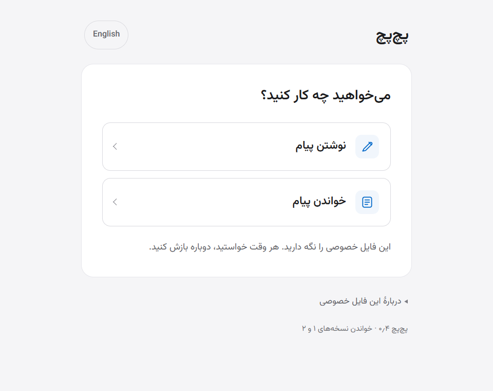
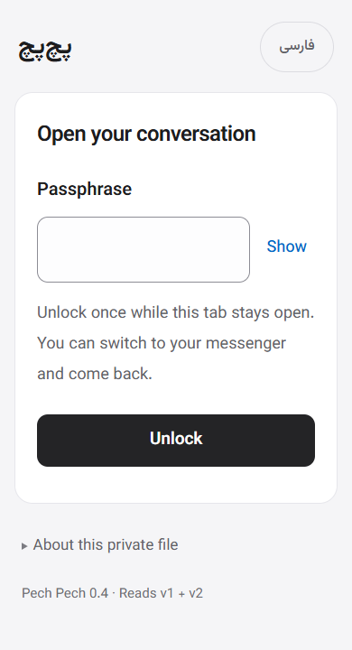
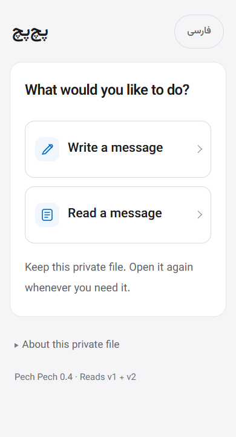
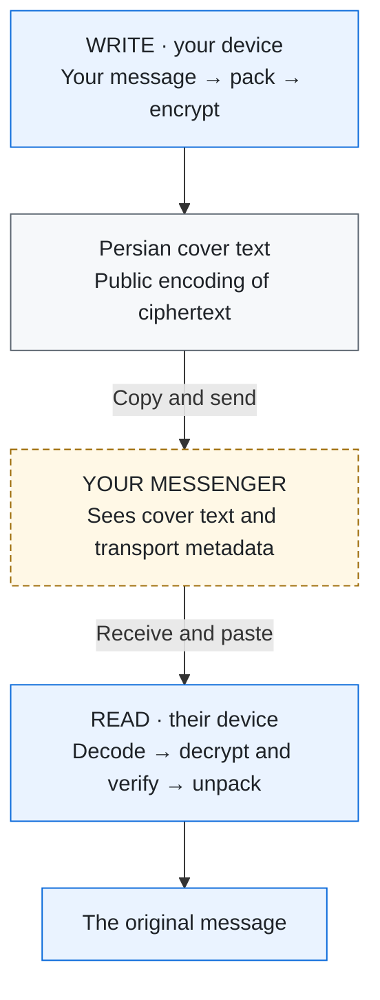
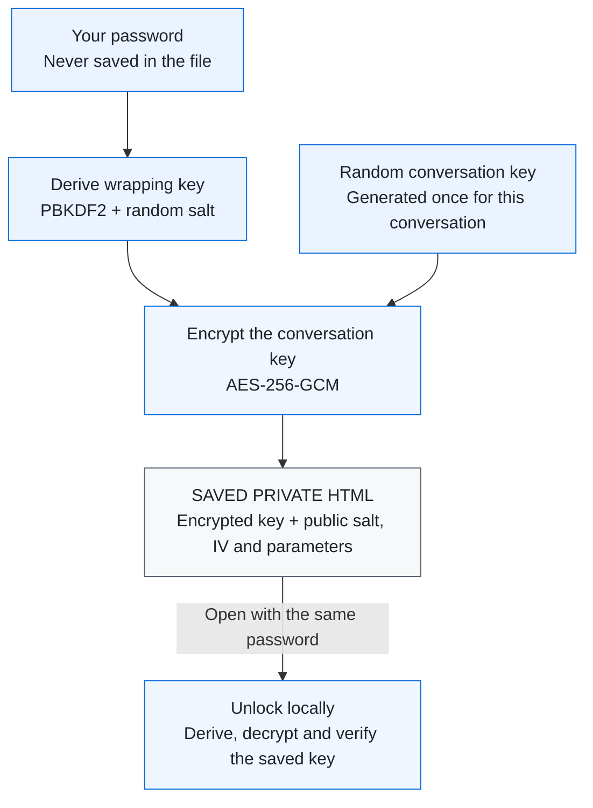

<h1 align="center">پچ‌پچ · Pech Pech</h1>

<p align="center">Write a message. Send Persian cover text. Read the original on the other side.</p>
<p align="center"><strong>One offline HTML file · No account · No installation · No AI</strong></p>

<p align="center">
  <a href="https://github.com/BodoVPN/bodo-pech-pech/releases/latest/download/bodo-pech-pech.html"><strong>Download the HTML / دریافت فایل</strong></a>
  &nbsp; · &nbsp;
  <a href="https://github.com/BodoVPN/bodo-pech-pech/releases/latest">Latest release</a>
  &nbsp; · &nbsp;
  <a href="#how-it-works">How it works</a>
</p>

<p align="center">
  
</p>
<p align="center"><sub>Actual v0.4.0, running offline in Windows Chrome. No message content is shown.</sub></p>

## Quick start

1. **Download and open** the HTML in Chrome or Edge.
2. **One person creates the conversation.** Choose a password or **Generate**, then **Make & save conversation file**.
3. **Share that same saved file privately.** Give the other person a copy and tell them the password separately. Both people need copies of **the same file**, not two independently created conversations.
4. **Open, unlock, and talk.** **Write a message** prepares Persian text to copy into your messenger. **Read a message** opens the received text you paste in. Copy all of it without changing the words.

<div dir="rtl">
<h2>شروع سریع</h2>
<ol>
  <li>فایل را <strong>دانلود کنید و در Chrome یا Edge باز کنید</strong>.</li>
  <li><strong>یک نفر گفت‌وگو را بسازد:</strong> رمز انتخاب کند یا «ساخت خودکار» را بزند، سپس «ساخت و ذخیرهٔ فایل گفت‌وگو» را بزند.</li>
  <li><strong>همان فایل ذخیره‌شده را خصوصی به نفر دوم بدهید</strong> و رمز را جداگانه برسانید. هر دو باید نسخه‌ای از <strong>همان فایل</strong> داشته باشید، نه دو گفت‌وگوی جدا.</li>
  <li>فایل خصوصی را باز کنید و رمز را وارد کنید. <strong>نوشتن پیام</strong> متن فارسی برای کپی در پیام‌رسان می‌سازد؛ در <strong>خواندن پیام</strong> متن دریافتی را بچسبانید. همهٔ متن را بدون تغییر کلمات کپی کنید.</li>
</ol>
<p>رمز را نگه دارید؛ فراموشی آن ممکن است دسترسی را از بین ببرد. برای گفت‌وگوی قبلی، «محافظت از گفت‌وگوی قبلی» را بزنید؛ نسخه‌های قدیمیِ بدون محافظت با این کار امن یا باطل نمی‌شوند.</p>
</div>

Passwords need **8 characters, a number and a symbol**; Persian/Arabic digits work too. **Generate** fills an editable random **16-character** suggestion. Keep it safe—there is no password reset. [Moving an old file or setup code?](#keep-an-existing-conversation)

<p align="center">
  
  
</p>
<p align="center"><sub>Unlock once, then choose Write or Read. Narrow desktop-browser views—not Android test results.</sub></p>

Switching to your messenger and **Done · clear messages** keep this tab unlocked. Done clears message fields and reply context. Closing, reloading or navigating away requires unlocking again.

## How it works

Think of it as **a locked key, an encrypted message, and a change of appearance**. They do different jobs:

| Part | What it does |
| --- | --- |
| **Your password** | Protects the conversation key inside the saved HTML file. |
| **The random conversation key** | Encrypts and authenticates messages. Both people use the same key; a new conversation gets a fresh one. |
| **The Persian wording** | Represents the encrypted bytes as sentences. Anyone can reverse this public encoding to ciphertext; it adds no cryptographic strength. |

The public starter download has **no private conversation key**. Setup creates one locally. The file you deliberately save contains its encrypted form, never the password or plaintext key.

### 1 · A message goes across



**Blue steps happen locally.** The messenger transports the cover text; it is not trusted to encrypt the private message. It can see the cover, participants, timing and length.

The receiver needs the conversation key to decrypt and authenticate the ciphertext. The app verifies it **before** showing the original text. A wrong key or modified message fails instead of producing a guessed message.

**Reply takes the same path back.** The public cover provides rough topic/turn continuity. No AI reads, summarizes or rewrites the private text. The wording can still sound artificial, and short messages can produce long covers.

### 2 · The saved key stays locked



This protects a **stolen, locked file** against access without the password, subject to password guessing and implementation limits. It does not protect an already-unlocked or compromised device. The password, derived wrapping key and raw conversation key are not saved in new exports.

<details>
<summary><strong>A closer look at the bytes</strong></summary>

**Saving the key.** Setup generates a random **32-byte conversation key**. The password is normalized to **NFC**, then encoded as UTF-8: spaces are not trimmed, and Persian/Arabic letters are not substituted. **PBKDF2-HMAC-SHA-256 at 600,000 iterations**, with a random **16-byte salt**, derives the temporary wrapping key. **AES-256-GCM**, with a fresh **12-byte IV**, encrypts the conversation key. The envelope's version/parameters are authenticated, with a **128-bit tag**. Only the encrypted key and public salt/IV/parameters go into the saved HTML. Unlock repeats derivation, authenticates/decrypts, and imports the recovered key locally as a non-extractable `CryptoKey`. [Storage specification →](docs/KEY-STORAGE.md)

**Sending a message.** The exact input becomes UTF-8 bytes. A fixed, lossless byte substitution is used only when it helps; otherwise the raw bytes are retained. AES-256-GCM encrypts them with a new random nonce and authenticates the message version/profile. A deterministic reversible Persian dialogue grammar maps the resulting packet to cover text. Receiving reverses that order: decode → decrypt **and verify** → unpack → decode UTF-8. No private-text normalization is applied; browser textareas normalize line endings to LF before the app reads them. Messages are limited to **2,048 UTF-8 bytes**. [Message format →](docs/FORMAT-V2.md)

**Staying local.** There is no server, AI model, application network request or browser-storage persistence. The existing messenger provides transport and may need internet. Exports use a clean build-time template, never the live message screen. Clearing cannot guarantee erasure from browser/OS memory or clipboard history. [Implementation →](src/main.ts)

</details>

## Security limits

> **Experimental and not independently audited.** Persian cover text is detectable encoding, not a guarantee of naturalness, concealment or secure-messenger equivalence. Read the [security boundaries](SECURITY.md) before relying on it.

- **Passwords can be guessed offline.** Meeting the eight-character minimum does not make a chosen password strong; the generated value is the stronger option. Losing the password can lose access.
- **Handover matters.** Use a trusted HTML copy, share the same private file confidentially, and share its password separately. Old unprotected files/codes remain usable after migration.
- **Both people share one key.** There is no sender-specific authentication, forward secrecy or replay protection. A compromised device is outside this protection.
- **Transport remains visible.** The messenger and observers can see cover text and transport metadata. Copy/paste changes or truncation can prevent a message from opening.

## Keep an existing conversation

In the starter, choose a password, open **Protect an older conversation**, and select the old private HTML file **or** paste its BPP1 setup code. Save the protected copy. It keeps the original key and reads existing v1/v2 messages; old HTML is read as data, never executed.

Existing protected files still accept their original passwords, even if they do not meet today's creation rules. **Migration does not secure or revoke old unprotected copies.** [Migration details →](docs/KEY-STORAGE.md#runtime-and-migration)

## Compatibility

| Platform | Status |
| --- | --- |
| **Windows Chrome & Edge** | Actual saved-file, offline exchange and reply flows tested. |
| **Android / Galaxy A51-class phones** | Target platform; **not verified on a real device**. |

The single file is about **407 KiB**, with its font, CSS and script embedded. Open it in a full browser, not a file previewer. See [verification](docs/VERIFICATION.md) and the [Android checklist](docs/ANDROID-CHECK.md).

## Build and check

Users need only the downloaded HTML. Developers need Node.js 24+ and npm:

```sh
npm ci
npm run check
```

`npm run build` produces `bodo-pech-pech.html`; do not distribute the unbundled source page. Browser checks use installed Chrome and Edge. Keep personal conversation files out of Git.

| Explore | Read more |
| --- | --- |
| Formats | [Message v2](docs/FORMAT-V2.md) · [Legacy v1](docs/FORMAT.md) · [Protected key storage](docs/KEY-STORAGE.md) |
| Evidence | [Verification](docs/VERIFICATION.md) · [Historical codec comparison](docs/VERIFICATION-V2.md) |
| Visuals | [Screenshot provenance](docs/assets/README.md) · [Font attribution](assets/fonts/vazirmatn/README.md) |

Typography uses **Vazirmatn v33.003**, embedded with its SIL Open Font License 1.1 and attribution. No project software license has been selected. No AI is shipped; the [earlier model investigation](docs/MODEL-NOTE.md) is historical only.
